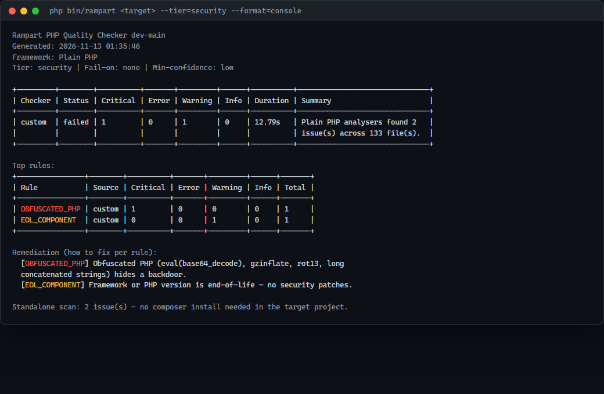

---
layout: default
title: Rampart PHP — Tiếng Việt
description: Tài liệu tiếng Việt của Rampart PHP.
---

# Rampart PHP — Tiếng Việt

[English]({{ site.baseurl }}/en/) · [日本語]({{ site.baseurl }}/ja/) · [Tiếng Việt]({{ site.baseurl }}/vi/)

Quality gate độc lập cho **PHP thuần và mọi framework** — Slim, CodeIgniter 4,
FuelPHP, Symfony, Phalcon, Laravel. Tool chạy trên PHP **7.4+**; code target chỉ
được parse, không thực thi, nên quét được mọi phiên bản PHP.



## Hệ sinh thái Rampart

| Dự án | Phạm vi | Repository | Tài liệu |
|---|---|---|---|
| **Rampart** | Quality gate Laravel (Artisan) | [GitHub](https://github.com/thiennhant95/Rampart) | [Pages](https://thiennhant95.github.io/Rampart/) |
| **Rampart PHP** | PHP thuần + đa framework, PHP 7.4+ | [GitHub](https://github.com/thiennhant95/Rampart-PHP) | [Pages](https://thiennhant95.github.io/Rampart-PHP/) |
| **Rampart WP** | Plugin/theme WordPress | [GitHub](https://github.com/thiennhant95/Rampart-Wordpress) | [Pages](https://thiennhant95.github.io/Rampart-Wordpress/) |

## Cài đặt

```bash
git clone https://github.com/thiennhant95/Rampart-PHP.git
cd Rampart-PHP
composer install
```

Không cần cài gì vào project đích. Rule `custom` chạy với 0 dependency của
target; các tool `phpcs`/`phpstan`/`phpunit`/`composer audit` chỉ dùng `vendor/`
của target khi có.

## Chạy nhanh

```bash
# Quét bảo mật
php bin/rampart /path/to/project --tier=security --fail-on=none

# Xuất tất cả báo cáo
php bin/rampart /path/to/project --format=all --output=reports/rampart

# Xem → baseline → chỉ fail khi có finding mới
php bin/rampart /path/to/project --fail-on=none
php bin/rampart /path/to/project --baseline-generate
php bin/rampart /path/to/project --ci --baseline-file=baseline.json
```

Exit code: `0` pass · `1` vượt ngưỡng · `2` sai tham số · `3` lỗi nội bộ.

## Framework hỗ trợ

Nhận diện qua `composer.json` và marker; ép bằng `--framework=`.

| Framework | Nhận diện | Phân tích route / auth |
|---|---|---|
| PHP thuần | fallback | thư mục PSR-4, template, `public/` |
| Slim 4 | `slim/slim` | `routes/*.php`, `->add()/->middleware()` |
| CodeIgniter 4 | `spark` + `app/Config` | `Routes.php`, filter auth |
| FuelPHP | `fuel/app` | `before()` trong controller + parent |
| Symfony | `config/bundles.php` / `src/Kernel.php` | attribute + YAML route + `security.yaml` |
| Phalcon | `phalcon/cphalcon` / `app/controllers` | `routes.php`, ACL `beforeExecuteRoute` |
| Laravel | `laravel/framework` | semantic index đầy đủ (route, middleware, policy) |

Các analyzer chỉ dành cho Laravel (BAC/IDOR, mass assignment, CSRF, Blade,
migration, route validation) chỉ chạy khi nhận diện Laravel, tránh false
positive trên framework khác.

## Kiểm tra gì

- **Bảo mật:** SQLi (kể cả PDO `query()`), command injection, path traversal,
  SSRF, XSS, open redirect, SSTI, XXE, LDAP injection, eval/deserialize,
  hardcoded secret, hash/crypto/random yếu, cookie/session, header injection.
- **OWASP Top 10 2021:** A01/A03/A05/A07/A10 trong JSON/HTML/SARIF.
- **Route auth:** route thay đổi dữ liệu thiếu authorization (Slim/CI4/FuelPHP/
  Symfony/Phalcon).
- **Tùy chọn:** taint engine, thiếu test (`--coverage`), convention, debug output,
  forensics (`public/*.php`, PHP obfuscated), quyền file/EOL.

Bảng đầy đủ: [README](https://github.com/thiennhant95/Rampart-PHP#custom-analyzer-rules)

## Báo cáo

| Format | File | Dùng cho |
|---|---|---|
| `console` | stdout | Terminal |
| `json` | `rampart-report.json` | CI, tooling |
| `html` | `rampart-report.html` | Developer |
| `md` | `rampart-report.md` | PR comment |
| `sarif` | `rampart-report.sarif` | GitHub code scanning |

HTML có 3 biến thể: `--no-remediation`, `--client`, `--all-variants`.

## CI

```yaml
- run: composer install --prefer-dist --no-progress
- run: php bin/rampart . --only=custom --ci --fail-on=error
  working-directory: tools/rampart
```

Thêm `--format=sarif` và upload `rampart-report.sarif` để hiện cảnh báo trên
GitHub. `custom` không cần `vendor/` của target.

## Baseline và giảm nhiễu

```bash
php bin/rampart /path --baseline-generate
php bin/rampart /path --ci --baseline-file=baseline.json
php bin/rampart /path --min-severity=error --ignore=ROUTE_MISSING_AUTH
```

Suppression inline: `// rampart-ignore RULE_ID` hoặc
`// rampart-ignore-next-line RULE_ID`. Alias cũ `quality-checker-ignore` vẫn
được chấp nhận.

## Hiệu năng

AST được đọc/parse một lần cho mỗi file mỗi lần chạy. `bin/rampart` nâng
memory floor CLI lên 512M; taint engine có thể cần thêm trên cây rất lớn
(`php -d memory_limit=1G`).

## Phát triển

```bash
composer check   # phpcs + phpstan + phpunit
composer smoke   # build/install archive, chạy binary đã cài
```

Tool tự dogfood; self-scan 0 finding, kể cả khi bật toàn bộ rule tùy chọn.

## Giấy phép

MIT © 2026 Rampart.
